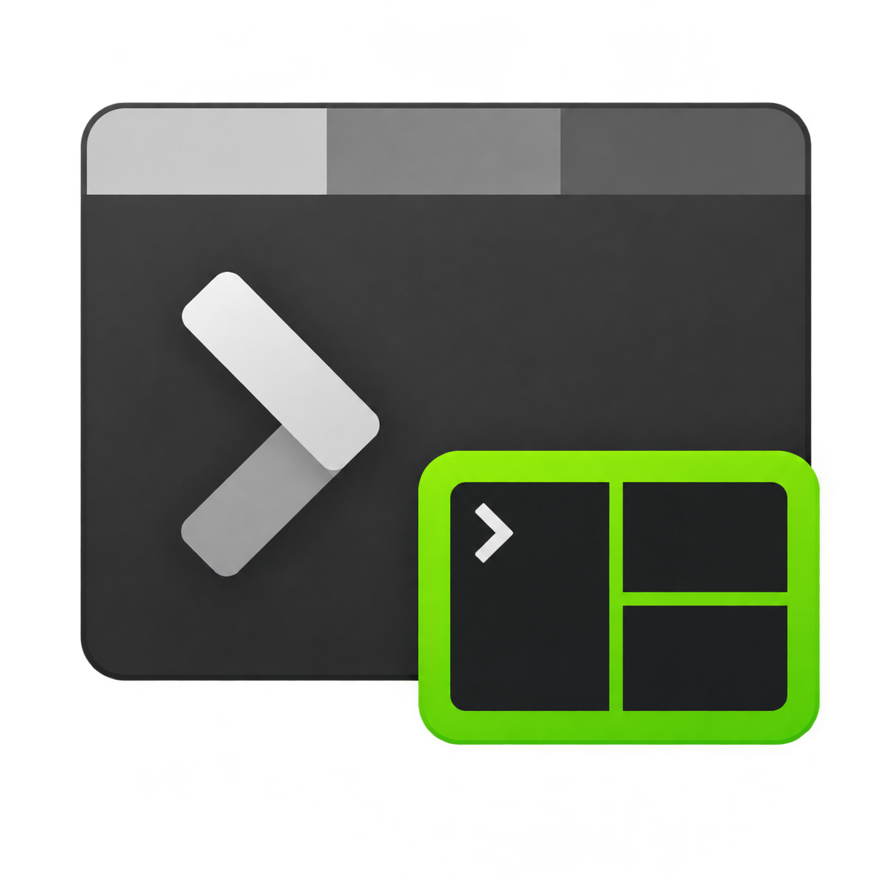

# tmux-winterm

<p>
  
</p>

**Native tmux control-mode integration for Windows Terminal.**

An experimental, independent fork of [microsoft/terminal](https://github.com/microsoft/terminal),
inspired by [iTerm2's tmux integration](https://iterm2.com/documentation-tmux-integration.html).
Remote tmux windows become native Terminal tabs, and remote panes become native
terminal controls with their own scrollback, colors, selection, and rendering.
One SSH/control connection carries the panes belonging to that connection.

This is not an official Microsoft distribution or a claim of full iTerm2 parity.
The portable executable is still named `WindowsTerminal.exe`; renaming the
repository does not rename the application or its package identity.

[Download v0.2.2](https://github.com/souradeep100/tmux-winterm/releases/tag/tmux-control-v0.2.2)
| [Usage guide](doc/cascadia/Tmux.md)
| [Architecture and Copilot handoff](doc/cascadia/TmuxControlModeDesign.md)

## What the tmux integration adds

| Feature | Behavior |
|---|---|
| Native tabs and panes | Each control connection opens a dedicated Terminal window, reusing the existing native window host. |
| Native scrollback and rendering | Live output uses Terminal's VT parser, text buffer, and renderer rather than periodic screen captures. |
| Session-bound controls | **+** and normal new-tab shortcuts create tmux windows in that session, including while Settings is selected. |
| Ordinary Terminal behavior | Non-tmux windows retain normal **+**, profiles, and dropdowns. |
| Persistent-session reattachment | Reconnect to a surviving tmux session and restore its windows, layouts, retained history, and exported terminal state. |
| Optional SSH launch | Enable `ssh.useTmux` for direct SSH profiles; ordinary SSH remains the default. Manual `tmux -CC` entry also works. |
| Responsive input/output path | Input is queued without waiting for command acknowledgments; already-received same-pane output is coalesced without a timer. |
| Compatibility fallback | Exercised with tmux 2.9a and 3.4; per-window sizing falls back to legacy global sizing where required. |

## Download and run

The published build is an **experimental portable x64 ZIP**:

- [WindowsTerminal-tmux-control-v0.2.2-win-x64.zip](https://github.com/souradeep100/tmux-winterm/releases/download/tmux-control-v0.2.2/WindowsTerminal-tmux-control-v0.2.2-win-x64.zip)
- [SHA-256 checksum](https://github.com/souradeep100/tmux-winterm/releases/download/tmux-control-v0.2.2/WindowsTerminal-tmux-control-v0.2.2-win-x64.zip.sha256)

Extract the complete archive to a new folder and run `WindowsTerminal.exe` from
that folder. Do not copy just the executable or overwrite a running installation.
The portable build keeps its settings separately and does not auto-update.

The Microsoft Store, winget, and Canary links in the upstream documentation below
install **upstream Windows Terminal**, not this fork's tmux feature.

The branch was rebased onto upstream `main` after v0.2.2 was published.
**The v0.2.2 assets have not been rebuilt or replaced after that rebase.**
See the release notes and handoff document for the source snapshot and validation
history; a release binary and the latest branch tip are not interchangeable.

## Connect to tmux

Install tmux on the remote machine, connect with SSH, then run:

```sh
tmux -u -CC new-session -A -s windows-terminal
```

Or, in this fork's **Settings > Profiles > [SSH profile] > General**, enable
**Use tmux control mode**. The equivalent profile setting is:

```json
{
    "name": "Remote SSH",
    "commandline": "ssh.exe example-host",
    "ssh.useTmux": true,
    "historySize": 9001
}
```

The option is off by default and applies to new connections. It supports direct
`ssh`/`ssh.exe` profiles, not arbitrary shell wrappers. Keep positional remote
commands out of the base SSH command line when enabling it.
Manual control entry also works from supported local transports such as WSL.

## Window and session behavior

- Each control connection opens a separate native session window with **+** and
  **Settings**, without a profile dropdown.
- Native split, focus, directional resize, and zoom actions operate on tmux.
- Closing the original gateway tab leaves its dedicated session window running.
- Closing the dedicated **window** detaches without killing remote programs.
  Explicitly closing a tmux **pane or tab** kills the corresponding remote panes.
- Reopening the SSH profile reattaches to the surviving `windows-terminal`
  session. For manual entry, reconnect and rerun the attach command.
- Escape does not detach the gateway; Escape inside a native tmux pane remains
  application input. The gateway's `n` creates a tmux window; `X` leaves a broken
  control stream.

Reattachment is **not process resurrection** after a tmux server or remote
machine restart.

## Limitations and connection reliability

This remains experimental. It does not support moving tmux tabs/panes between
Terminal windows or mixing them with unrelated local panes. State restoration
depends on the server's exported modes; tmux 3.4 does not export bracketed-paste
state. Previously drawn image protocols and unavailable key-reporting modes
cannot be reconstructed. Split-orientation changes currently use remote
`tmux select-layout`.

**Automatic SSH reconnect is not implemented.** Windows sleep / Modern Standby,
network loss, or an expired connection can end the transport even while tmux and
its remote programs survive. Keepalives cannot reliably run while Windows
suspends the SSH process; reconnect manually to restore the session.


## Source and architecture

The default development branch is `schakrabarti/tmux-control`.
The fork's `main` branch remains separate for upstream tracking.

```powershell
git clone --branch schakrabarti/tmux-control https://github.com/souradeep100/tmux-winterm.git
Set-Location tmux-winterm
```

```text
native TermControl <-> TmuxPaneConnection <-> TmuxSession + protocol Client
                                                <-> existing SSH/ConPTY <-> tmux
dedicated TerminalPage <-> TmuxWindow controller <-> existing native window host
```

Protocol parsing lives in `TmuxControl.h`; transport and pane adapters in
`TmuxConnection.*`; session-window policy in `TmuxWindow.*`; and native layout
adaptation in `TmuxIntegration.cpp`, under `src\cascadia\TerminalApp`.
The implementation reuses Terminal's renderer and native host, not a second
windowing/rendering stack.

For builds, see [doc/building.md](doc/building.md) and the prerequisites below.
For design decisions, lifecycle invariants, validation history, and a prompt
for continuing in a fresh Copilot session, read
[TmuxControlModeDesign.md](doc/cascadia/TmuxControlModeDesign.md).
The feature-specific test/soak harnesses used during development were local and
are not included in the repository.

## Attribution and contributions

Windows Terminal and the console infrastructure are developed by Microsoft and
the upstream contributors. This fork retains their source, attribution,
[license](LICENSE), [notices](NOTICE.md), and upstream documentation below.
Fork development and documentation were AI-assisted under the owner's design
direction. The project logo is an AI-generated adaptation of the upstream
Terminal icon with a tmux-inspired split-pane badge.
Read [AGENTS.md](AGENTS.md) and [CONTRIBUTING.md](CONTRIBUTING.md)
before contributing. Upstream PR #20864 remains closed; this fork is not an
upstream-approved implementation.

---

<details>
<summary><strong>Original upstream Windows Terminal README</strong></summary>

The following is retained upstream documentation. Its branding, build badge,
downloads, release channels, and team contacts refer to `microsoft/terminal`,
not to the `tmux-winterm` fork or its build status.


[](https://dev.azure.com/shine-oss/terminal/_build/latest?definitionId=1&branchName=main)

# Welcome to the Windows Terminal, Console and Command-Line repo

<details>
  <summary><strong>Table of Contents</strong></summary>

- [Installing and running Windows Terminal](#installing-and-running-windows-terminal)
  - [Microsoft Store \[Recommended\]](#microsoft-store-recommended)
  - [Other install methods](#other-install-methods)
    - [Via GitHub](#via-github)
    - [Via Windows Package Manager CLI (aka winget)](#via-windows-package-manager-cli-aka-winget)
    - [Via Chocolatey (unofficial)](#via-chocolatey-unofficial)
    - [Via Scoop (unofficial)](#via-scoop-unofficial)
- [Installing Windows Terminal Canary](#installing-windows-terminal-canary)
- [Terminal \& Console Overview](#terminal--console-overview)
  - [Windows Terminal](#windows-terminal)
  - [The Windows Console Host](#the-windows-console-host)
  - [Shared Components](#shared-components)
  - [Creating the new Windows Terminal](#creating-the-new-windows-terminal)
- [Resources](#resources)
- [FAQ](#faq)
  - [I built and ran the new Terminal, but it looks just like the old console](#i-built-and-ran-the-new-terminal-but-it-looks-just-like-the-old-console)
- [Documentation](#documentation)
- [Contributing](#contributing)
- [Communicating with the Team](#communicating-with-the-team)
- [Developer Guidance](#developer-guidance)
- [Prerequisites](#prerequisites)
- [Building the Code](#building-the-code)
  - [Building in PowerShell](#building-in-powershell)
  - [Building in Cmd](#building-in-cmd)
- [Running \& Debugging](#running--debugging)
  - [Coding Guidance](#coding-guidance)
- [Code of Conduct](#code-of-conduct)

</details>

<br />

This repository contains the source code for:

* [Windows Terminal](https://aka.ms/terminal)
* [Windows Terminal Preview](https://aka.ms/terminal-preview)
* The Windows console host (`conhost.exe`)
* Components shared between the two projects
* [ColorTool](./src/tools/ColorTool)
* [Sample projects](./samples)
  that show how to consume the Windows Console APIs

Related repositories include:

* [Windows Terminal Documentation](https://learn.microsoft.com/windows/terminal)
  ([Repo: Contribute to the docs](https://github.com/MicrosoftDocs/terminal))
* [Console API Documentation](https://github.com/MicrosoftDocs/Console-Docs)
* [Cascadia Code Font](https://github.com/Microsoft/Cascadia-Code)

## Installing and running Windows Terminal

> [!NOTE]
> Windows Terminal requires Windows 10 2004 (build 19041) or later

### Microsoft Store [Recommended]

Install the [Windows Terminal from the Microsoft Store][store-install-link].
This allows you to always be on the latest version when we release new builds
with automatic upgrades.

This is our preferred method.

### Other install methods

#### Via GitHub

For users who are unable to install Windows Terminal from the Microsoft Store,
released builds can be manually downloaded from this repository's [Releases
page](https://github.com/microsoft/terminal/releases).

Download the `Microsoft.WindowsTerminal_<versionNumber>.msixbundle` file from
the **Assets** section. To install the app, you can simply double-click on the
`.msixbundle` file, and the app installer should automatically run. If that
fails for any reason, you can try the following command at a PowerShell prompt:

```powershell
# NOTE: If you are using PowerShell 7+, please run
# Import-Module Appx -UseWindowsPowerShell
# before using Add-AppxPackage.

Add-AppxPackage Microsoft.WindowsTerminal_<versionNumber>.msixbundle
```

> [!NOTE]
> If you install Terminal manually:
>
> * You may need to install the [VC++ v14 Desktop Framework Package](https://learn.microsoft.com/troubleshoot/cpp/c-runtime-packages-desktop-bridge#how-to-install-and-update-desktop-framework-packages).
>   This should only be necessary on older builds of Windows 10 and only if you get an error about missing framework packages.
> * Terminal will not auto-update when new builds are released so you will need
>   to regularly install the latest Terminal release to receive all the latest
>   fixes and improvements!

#### Via Windows Package Manager CLI (aka winget)

[winget](https://github.com/microsoft/winget-cli) users can download and install
the latest Terminal release by installing the `Microsoft.WindowsTerminal`
package:

```powershell
winget install --id Microsoft.WindowsTerminal -e
```

> [!NOTE]
> Dependency support is available in WinGet version [1.6.2631 or later](https://github.com/microsoft/winget-cli/releases). To install the Terminal stable release 1.18 or later, please make sure you have the updated version of the WinGet client.

#### Via Chocolatey (unofficial)

[Chocolatey](https://chocolatey.org) users can download and install the latest
Terminal release by installing the `microsoft-windows-terminal` package:

```powershell
choco install microsoft-windows-terminal
```

To upgrade Windows Terminal using Chocolatey, run the following:

```powershell
choco upgrade microsoft-windows-terminal
```

If you have any issues when installing/upgrading the package please go to the
[Windows Terminal package
page](https://chocolatey.org/packages/microsoft-windows-terminal) and follow the
[Chocolatey triage process](https://chocolatey.org/docs/package-triage-process)

#### Via Scoop (unofficial)

[Scoop](https://scoop.sh) users can download and install the latest Terminal
release by installing the `windows-terminal` package:

```powershell
scoop bucket add extras
scoop install windows-terminal
```

To update Windows Terminal using Scoop, run the following:

```powershell
scoop update windows-terminal
```

If you have any issues when installing/updating the package, please search for
or report the same on the [issues
page](https://github.com/lukesampson/scoop-extras/issues) of Scoop Extras bucket
repository.

---

## Installing Windows Terminal Canary
Windows Terminal Canary is a nightly build of Windows Terminal. This build has the latest code from our `main` branch, giving you an opportunity to try features before they make it to Windows Terminal Preview.

Windows Terminal Canary is our least stable offering, so you may discover bugs before we have had a chance to find them.

Windows Terminal Canary is available as an App Installer distribution and a Portable ZIP distribution.

The App Installer distribution supports automatic updates. Due to platform limitations, this installer only works on Windows 11.

The Portable ZIP distribution is a portable application. It will not automatically update and will not automatically check for updates. This portable ZIP distribution works on Windows 10 (19041+) and Windows 11.

| Distribution  | Architecture    | Link                                                 |
|---------------|:---------------:|------------------------------------------------------|
| App Installer | x64, arm64, x86 | [Download](https://aka.ms/terminal-canary-installer) |
| Portable ZIP  | x64             | [Download](https://aka.ms/terminal-canary-zip-x64)   |
| Portable ZIP  | ARM64           | [Download](https://aka.ms/terminal-canary-zip-arm64) |
| Portable ZIP  | x86             | [Download](https://aka.ms/terminal-canary-zip-x86)   |

_Learn more about the [types of Windows Terminal distributions](https://learn.microsoft.com/windows/terminal/distributions)._

---

## Terminal & Console Overview

Please take a few minutes to review the overview below before diving into the
code:

### Windows Terminal

Windows Terminal is a new, modern, feature-rich, productive terminal application
for command-line users. It includes many of the features most frequently
requested by the Windows command-line community including support for tabs, rich
text, globalization, configurability, theming & styling, and more.

The Terminal will also need to meet our goals and measures to ensure it remains
fast and efficient, and doesn't consume vast amounts of memory or power.

### The Windows Console Host

The Windows Console host, `conhost.exe`, is Windows' original command-line user
experience. It also hosts Windows' command-line infrastructure and the Windows
Console API server, input engine, rendering engine, user preferences, etc. The
console host code in this repository is the actual source from which the
`conhost.exe` in Windows itself is built.

Since taking ownership of the Windows command-line in 2014, the team added
several new features to the Console, including background transparency,
line-based selection, support for [ANSI / Virtual Terminal
sequences](https://en.wikipedia.org/wiki/ANSI_escape_code), [24-bit
color](https://devblogs.microsoft.com/commandline/24-bit-color-in-the-windows-console/),
a [Pseudoconsole
("ConPTY")](https://devblogs.microsoft.com/commandline/windows-command-line-introducing-the-windows-pseudo-console-conpty/),
and more.

However, because Windows Console's primary goal is to maintain backward
compatibility, we have been unable to add many of the features the community
(and the team) have been wanting for the last several years including tabs,
unicode text, and emoji.

These limitations led us to create the new Windows Terminal.

> You can read more about the evolution of the command-line in general, and the
> Windows command-line specifically in [this accompanying series of blog
> posts](https://devblogs.microsoft.com/commandline/windows-command-line-backgrounder/)
> on the Command-Line team's blog.

### Shared Components

While overhauling Windows Console, we modernized its codebase considerably,
cleanly separating logical entities into modules and classes, introduced some
key extensibility points, replaced several old, home-grown collections and
containers with safer, more efficient [STL
containers](https://docs.microsoft.com/en-us/cpp/standard-library/stl-containers?view=vs-2022),
and made the code simpler and safer by using Microsoft's [Windows Implementation
Libraries - WIL](https://github.com/Microsoft/wil).

This overhaul resulted in several of Console's key components being available
for re-use in any terminal implementation on Windows. These components include a
new DirectWrite-based text layout and rendering engine, a text buffer capable of
storing both UTF-16 and UTF-8, a VT parser/emitter, and more.

### Creating the new Windows Terminal

When we started planning the new Windows Terminal application, we explored and
evaluated several approaches and technology stacks. We ultimately decided that
our goals would be best met by continuing our investment in our C++ codebase,
which would allow us to reuse several of the aforementioned modernized
components in both the existing Console and the new Terminal. Further, we
realized that this would allow us to build much of the Terminal's core itself as
a reusable UI control that others can incorporate into their own applications.

The result of this work is contained within this repo and delivered as the
Windows Terminal application you can download from the Microsoft Store, or
[directly from this repo's
releases](https://github.com/microsoft/terminal/releases).

---

## Resources

For more information about Windows Terminal, you may find some of these
resources useful and interesting:

* [Command-Line Blog](https://devblogs.microsoft.com/commandline)
* [Command-Line Backgrounder Blog
  Series](https://devblogs.microsoft.com/commandline/windows-command-line-backgrounder/)
* Windows Terminal Launch: [Terminal "Sizzle
  Video"](https://www.youtube.com/watch?v=8gw0rXPMMPE&list=PLEHMQNlPj-Jzh9DkNpqipDGCZZuOwrQwR&index=2&t=0s)
* Windows Terminal Launch: [Build 2019
  Session](https://www.youtube.com/watch?v=KMudkRcwjCw)
* Run As Radio: [Show 645 - Windows Terminal with Richard
  Turner](https://www.runasradio.com/Shows/Show/645)
* Azure DevOps Podcast: [Episode 54 - Kayla Cinnamon and Rich Turner on DevOps
  on the Windows
  Terminal](http://azuredevopspodcast.clear-measure.com/kayla-cinnamon-and-rich-turner-on-devops-on-the-windows-terminal-team-episode-54)
* Microsoft Ignite 2019 Session: [The Modern Windows Command Line: Windows
  Terminal -
  BRK3321](https://myignite.techcommunity.microsoft.com/sessions/81329?source=sessions)

---

## FAQ

### I built and ran the new Terminal, but it looks just like the old console

Cause: You're launching the incorrect solution in Visual Studio.

Solution: Make sure you're building & deploying the `CascadiaPackage` project in
Visual Studio.

> [!NOTE]
> `OpenConsole.exe` is just a locally-built `conhost.exe`, the classic
> Windows Console that hosts Windows' command-line infrastructure. OpenConsole
> is used by Windows Terminal to connect to and communicate with command-line
> applications (via
> [ConPty](https://devblogs.microsoft.com/commandline/windows-command-line-introducing-the-windows-pseudo-console-conpty/)).

---

## Documentation

All project documentation is located at [aka.ms/terminal-docs](https://aka.ms/terminal-docs). If you would like
to contribute to the documentation, please submit a pull request on the [Windows
Terminal Documentation repo](https://github.com/MicrosoftDocs/terminal).

---

## Contributing

We are excited to work alongside you, our amazing community, to build and
enhance Windows Terminal\!

***BEFORE you start work on a feature/fix***, please read & follow our
[Contributor's
Guide](./CONTRIBUTING.md) to
help avoid any wasted or duplicate effort.

## Communicating with the Team

The easiest way to communicate with the team is via GitHub issues.

Please file new issues, feature requests and suggestions, but **DO search for
similar open/closed preexisting issues before creating a new issue.**

If you would like to ask a question that you feel doesn't warrant an issue
(yet), please reach out to us via Twitter:

* Christopher Nguyen, Product Manager:
  [@nguyen_dows](https://twitter.com/nguyen_dows)
* Dustin Howett, Engineering Lead: [@dhowett](https://twitter.com/DHowett)
* Mike Griese, Senior Developer: [@zadjii@mastodon.social](https://mastodon.social/@zadjii)
* Carlos Zamora, Developer: [@cazamor_msft](https://twitter.com/cazamor_msft)
* Pankaj Bhojwani, Developer
* Leonard Hecker, Developer: [@LeonardHecker](https://twitter.com/LeonardHecker)

## Developer Guidance

## Prerequisites

You can configure your environment to build Terminal in one of two ways:

### Using WinGet configuration file

After cloning the repository, you can use a [WinGet configuration file](https://learn.microsoft.com/en-us/windows/package-manager/configuration/#use-a-winget-configuration-file-to-configure-your-machine)
to set up your environment. The [default configuration file](.config/configuration.winget) installs Visual Studio 2026 Community & rest of the required tools. There are two other variants of the configuration file available in the [.config](.config) directory for Enterprise & Professional editions of Visual Studio 2026. To run the default configuration file, you can either double-click the file from explorer or run the following command:

```powershell
winget configure .config\configuration.winget
```

### Manual configuration

* You must be running Windows 10 2004 (build >= 10.0.19041.0) or later to run
  Windows Terminal
* You must [enable Developer Mode in the Windows Settings
  app](https://learn.microsoft.com/windows/uwp/get-started/enable-your-device-for-development)
  to locally install and run Windows Terminal
* You must have [PowerShell 7 or later](https://github.com/PowerShell/PowerShell/releases/latest) installed
* You must have the [Windows 11 (10.0.26100) SDK](https://developer.microsoft.com/windows/downloads/windows-sdk/) installed at version 10.0.26100.8249 or greater.
* You must have at least [VS 2026](https://visualstudio.microsoft.com/downloads/) version 18.6 installed
* You must install the following Workloads via the VS Installer. Note: Opening
  the solution will [prompt you to install missing components automatically](https://devblogs.microsoft.com/setup/configure-visual-studio-across-your-organization-with-vsconfig/):
  * Desktop Development with C++
  * WinUI application development
* You must install the [.NET Framework 4.7.2 Targeting Pack](https://learn.microsoft.com/dotnet/framework/install/guide-for-developers#to-install-the-net-framework-developer-pack-or-targeting-pack) to build test projects

## Building the Code

OpenConsole.slnx may be built from within Visual Studio or from the command-line
using a set of convenience scripts & tools in the **/tools** directory:

### Building in PowerShell

```powershell
Import-Module .\tools\OpenConsole.psm1
Set-MsBuildDevEnvironment
Invoke-OpenConsoleBuild
```

### Building in Cmd

```shell
.\tools\razzle.cmd
bcz
```

## Running & Debugging

To debug the Windows Terminal in VS, right click on `CascadiaPackage` (in the
Solution Explorer) and go to properties. In the Debug menu, change "Application
process" and "Background task process" to "Native Only".

You should then be able to build & debug the Terminal project by hitting
<kbd>F5</kbd>. Make sure to select either the "x64" or the "x86" platform - the
Terminal doesn't build for "Any Cpu" (because the Terminal is a C++ application,
not a C# one).

> 👉 You will _not_ be able to launch the Terminal directly by running the
> WindowsTerminal.exe. For more details on why, see
> [#926](https://github.com/microsoft/terminal/issues/926),
> [#4043](https://github.com/microsoft/terminal/issues/4043)

### Coding Guidance

Please review these brief docs below about our coding practices.

> 👉 If you find something missing from these docs, feel free to contribute to
> any of our documentation files anywhere in the repository (or write some new
> ones!)

This is a work in progress as we learn what we'll need to provide people in
order to be effective contributors to our project.

* [Coding Style](./doc/STYLE.md)
* [Code Organization](./doc/ORGANIZATION.md)
* [Exceptions in our legacy codebase](./doc/EXCEPTIONS.md)
* [Helpful smart pointers and macros for interfacing with Windows in WIL](./doc/WIL.md)

---

## Code of Conduct

This project has adopted the [Microsoft Open Source Code of
Conduct][conduct-code]. For more information see the [Code of Conduct
FAQ][conduct-FAQ] or contact [opencode@microsoft.com][conduct-email] with any
additional questions or comments.

[conduct-code]: https://opensource.microsoft.com/codeofconduct/
[conduct-FAQ]: https://opensource.microsoft.com/codeofconduct/faq/
[conduct-email]: mailto:opencode@microsoft.com
[store-install-link]: https://aka.ms/terminal

</details>
