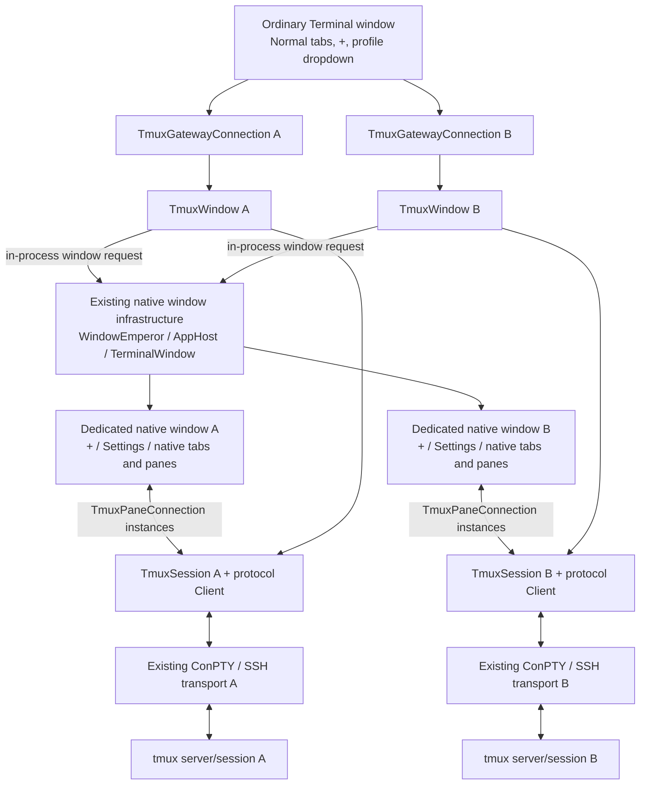
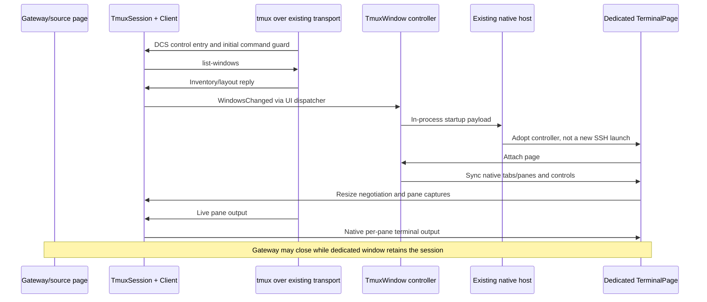

# Native tmux control mode: design and Copilot handoff

**Status:** Experimental fork implementation. **Context snapshot:** 2026-11-04.
This document is intended to let a new developer or Copilot session continue
without access to the original conversation, local test harnesses, or machine.
It is AI-assisted documentation of the implementation and owner-directed design,
not an upstream-approved specification. Read the repository's `AGENTS.md` and
applicable contribution policies before acting.

## Start here in a new session

The feature already exists. Do not start a second implementation or replace it
with ordinary text-mode tmux. Verify the current checkout against this snapshot;
code and newer owner instructions take precedence if they have changed.

| Item | Snapshot before this documentation commit |
|---|---|
| Fork | `souradeep100/tmux-winterm` (renamed from `souradeep100/terminal`) |
| Working branch | `schakrabarti/tmux-control` |
| Upstream | `microsoft/terminal`, `main` |
| Upstream base after rebase | `188822fa51dba7e11b64801483f4909db5fd020a` |
| Feature tip after rebase | `ce84e1846bc79ff9eed481e1430468b58c1d1e36` |
| Published experimental build | [tmux-control-v0.2.2](https://github.com/souradeep100/tmux-winterm/releases/tag/tmux-control-v0.2.2), portable x64 |
| Published build's source tag | `54ce8347a1120ae9ace8ceb555876fb7b80cfb6c`, before the rebase |
| Upstream PR | [#20864](https://github.com/microsoft/terminal/pull/20864), closed and unmerged; the owner requested that it remain closed |

All six feature patches replayed unchanged onto the new upstream base. A rebase
changes commit IDs, not previously published binaries. The rebased source was
built and exercised locally; v0.2.2 was not rebuilt or replaced after the rebase.
Do not treat the release executable as a build of current `HEAD`.

The fork was renamed to `tmux-winterm` and its default branch was set to
`schakrabarti/tmux-control` on 2026-11-04. The fork's `main` branch remains separate;
the repository rename did not rename executables, move tags, or rebuild releases.

### Reading order and continuation checklist

1. Read this document and [Tmux.md](Tmux.md). Confirm branch, worktree status,
   remotes, and the actual executable being investigated.
2. Read `TmuxControl.h` for protocol behavior; `TmuxConnection.*` for transport,
   input/output, and lifetimes; `TmuxWindow.*` for dedicated-window policy.
3. Read `TmuxIntegration.cpp`, then the relevant `TerminalPage`, `Tab`, `Pane`,
   settings, or host call sites identified in the source map below.
4. Preserve the UX and ownership invariants below. Use isolated tmux servers
   and a separate runtime/settings directory for experiments. Do not detach,
   kill, restart, or change configuration on an existing user session to test.
5. Separate a tmux-server exit from SSH/ConPTY loss and application-requested
   closure. Capture evidence before proposing a timeout or keepalive fix.

The owner selected **composition with the existing native window host**, a
**separate native window per control connection**, **session-bound + and Settings
only in that window**, **opt-in SSH launch**, and **reattachment to surviving
server state**. Those choices are intentional, not unfinished UI cleanup.

The original feature-specific tests and benchmarks were deliberately kept local,
not pushed. This document records past evidence, not a reproducible committed
test suite. Do not depend on original absolute paths, host aliases, credentials,
or session artifacts being available in a new environment.

Suggested opening prompt for a new session:

```text
Read AGENTS.md, doc/cascadia/TmuxControlModeDesign.md, and doc/cascadia/Tmux.md.
I am working on souradeep100/tmux-winterm, branch schakrabarti/tmux-control.
Use the existing tmux implementation and verify the current source/runtime.
Preserve native pane state, one transport per control connection, opt-in SSH,
and dedicated-window session ownership. Keep upstream PR #20864 closed.
Do not touch live user sessions or change power/SSH settings without approval.
Then work on the following task: <describe the new task>.
```

## Summary

Display tmux windows and panes using native Windows Terminal windows, tabs, and
terminal controls. One existing transport carries all panes belonging to a
control connection. Live output uses Terminal's VT parser and renderer rather
than periodic screen capture.

Each attached control connection opens a dedicated native Terminal window.
Its tab strip contains **+** and **Settings**, without a profile or workspace
dropdown. **+** creates a remote tmux window in that connection's session.
Ordinary Terminal windows retain their existing behavior.

The implementation uses a composed `TmuxWindow` controller. It does not subclass
or duplicate the native window host or introduce another rendering engine.

## Motivation and scope

Text-mode tmux multiplexes several applications into a single terminal grid.
This makes native scrollback, selection, search, tabs, and pane management less
direct to use. Control mode separates application output and layout information
from the text-mode presentation, allowing Terminal to provide the presentation.

The design follows the native-client model described in
[iTerm2's tmux integration documentation](https://iterm2.com/documentation-tmux-integration.html),
without claiming complete iTerm2 feature parity.

### Goals

- Preserve native rendering, colors, scrolling, selection, search, and copy/paste.
- Represent tmux windows as native tabs and tmux panes as native terminal controls.
- Keep different control connections isolated in separate native windows.
- Reattach to surviving server-side sessions and reconstruct their retained state.
- Support an opt-in SSH profile launch mode and manual `tmux -CC` entry.
- Avoid command-acknowledgment waits on the interactive input path.
- Isolate protocol, transport, window policy, and native-layout adaptation.

### Non-goals

- Restoring processes after the tmux server or remote machine restarts.
- Replacing tmux or changing its server-wide configuration automatically.
- Full parity with every tmux, iTerm2, or terminal graphics extension.
- Moving tmux tabs/panes between Terminal windows.
- Mixing unrelated local panes into a tmux tab.

## User experience

| Context or action | Behavior |
|---|---|
| Ordinary window: **+** or normal new-tab shortcut | Open the default profile. |
| Attach a control connection | Create a dedicated native window for that connection. |
| Dedicated window: **+** or normal new-tab shortcut | Create a tmux window in the bound session. |
| Dedicated window: Settings is selected, then **+** | Create and select a remote tmux tab, not a local terminal. |
| Dedicated window: **Settings** | Open the existing Settings UI. |
| Dedicated window: explicit profile launch | Open a separate ordinary window rather than mix local content into the session window. |
| Native split, directional resize, focus, or zoom | Issue the corresponding tmux operation. |
| Explicit close of a tmux pane or tab | Kill the corresponding remote pane or panes. |
| Close the original gateway | Keep the dedicated session window and its transport alive. |
| Close the dedicated session window | Detach; leave remote programs running. |
| Lose the transport | Disconnect the views; surviving server-side state can be reattached. |

Two connections, including connections to different machines, have separate
controllers and transports. Creating a tab in window A cannot select connection
B merely because B was used more recently.
Clients attached to the same server-side session still share that session's tmux
windows; native-window isolation does not change tmux's shared-session semantics.

The original tab remains a control gateway. Its keys are:

| Key | Action |
|---|---|
| `n` | Create a remote tmux window. |
| `X` | Leave a broken control stream that did not send its terminator. |

Escape does not detach the gateway. In native tmux panes it remains ordinary
application input. Closing the dedicated session window detaches cleanly.

## Configuration and entry points

The profile setting is persisted as `ssh.useTmux`, defaults to `false`, and is
exposed for direct SSH profiles in the profile's General settings.

```json
{
    "name": "Remote SSH",
    "commandline": "ssh.exe example-host",
    "ssh.useTmux": true
}
```

The stored base command line is not rewritten. For the example above, the
evaluated launch command is:

```text
ssh.exe -o "RemoteCommand=tmux -u -CC new-session -A -s windows-terminal" example-host -tt
```

Disabling the setting restores ordinary SSH for subsequent connections.
Explicit command-line replacement takes precedence over this launch mode.
Explicit append uses the base profile command rather than appending a remote
command to a tmux `RemoteCommand`.

Detection recognizes direct `ssh` and `ssh.exe` executable tokens, including
quoted paths and environment expansion. It does not interpret shell wrappers
such as `pwsh -c ssh ...`. Profiles using this option must not also contain a
positional remote command.

The automatic launch mode uses the fixed session name `windows-terminal`.
Manual entry can select another session:

```sh
tmux -u -CC new-session -A -s example-session
```

Manual control-mode detection remains available when the profile option is off.
An SSH client is not required for the manual path; it can also be entered from
another supported terminal transport, such as a WSL shell.

## Architecture



The gateway and dedicated window share the same session object. Creating a
native tab or native window does not establish a second SSH connection.

### Responsibilities and boundaries

| Component | Responsibility |
|---|---|
| `TmuxControl.h` / `Microsoft::Terminal::Tmux::Client` | Portable protocol parsing, command/reply bookkeeping, layout parsing, capture/restore, input encoding, and sizing capability negotiation. No transport I/O or XAML calls. |
| `TmuxConnection.*` / `TmuxSession` | Own the transport, serialize protocol state, queue command writes, dispatch output, and manage shared connection lifetime. |
| `TmuxGatewayConnection` | Decorate the original connection, pass ordinary output through, detect control entry, and provide gateway interaction. |
| `TmuxPaneConnection` | Adapt one remote pane to `ITerminalConnection` for a native `TermControl`. |
| `TmuxWindow.*` | Own the dedicated-window policy, startup handoff, session-bound controls, routing, and detach lifecycle. |
| `TmuxIntegration.cpp` | Adapt remote window/layout descriptions into native tabs and pane trees. |
| Existing native host and `TermControl` | Supply windowing, title bar, DPI behavior, input, terminal buffers, accessibility, and rendering. |
| Settings model/editor/adapter | Persist the opt-in profile setting and compute the launch command. |

The controller calls a small set of existing `TerminalPage` integration points.
This is composition with a host adapter, not complete compile-time independence:
the native-layout adapter and controller still depend on Terminal's page and
pane APIs. Tmux-specific controls are constructed by the controller; the shared
tab-row XAML and native HWND host are not forked.

Pane settings reuse the connecting profile. The dedicated native window uses
its own evaluated window settings; named-window overrides from the source
window are not explicitly cloned.

### Optional connection interfaces

Two optional interfaces extend connection behavior without adding methods to
the existing `ITerminalConnection` contract:

- `ITerminalConnectionWrapper` exposes the underlying connection so existing
  ConPTY-specific ownership and lifecycle operations can unwrap decorators.
- `ITerminalResponseHandler` separates terminal-generated responses from user
  input. Tmux pane connections discard those responses because tmux already
  answers application terminal queries on the remote PTY.

Private, cloaked COM identity markers distinguish gateway, pane, and window
startup objects. Their `From` helpers validate the marker before obtaining the
concrete implementation. Sharing a public interface is not sufficient proof
that an object has a particular implementation type.

## Attachment and dedicated-window creation

1. Wrap the existing ConPTY connection with a gateway/session/controller.
2. Forward ordinary terminal output unchanged until the `ESC P 1000 p`
   control-mode introducer is recognized.
3. Parse the initial command guard and query the server's window inventory.
4. On the first active inventory, request a new native window through the
   existing in-process window-creation event.
5. Carry the controller as an in-process `INewContentArgs` startup argument.
   The new page adopts it instead of launching another terminal process.
6. Bind the dedicated page, create its **+** and **Settings** controls, and
   reconstruct native tabs and panes from the inventory.
7. Negotiate sizing and restore newly attached pane contents.

The controller marshals window/layout work to the UI dispatcher. It keeps weak
references to the source and dedicated pages. A pending-window flag prevents
repeated inventories from creating duplicate native windows.
The controller startup argument is process-local, not a persisted or
cross-process command representation.



## Protocol and data flow

### Parsing

`Client::Feed` incrementally handles fragmented DCS framing, line records,
`%begin`/`%end`/`%error` command guards, and asynchronous notifications.
Protocol escape decoding preserves octal-escaped bytes and literal backslashes.

Window changes trigger a coalesced `list-windows` refresh. There is no periodic
screen-polling loop. Detach recognizes `%exit` and the DCS string terminator.
Force-exit recovery returns subsequent bytes to ordinary stream processing when
the transport omitted a terminator.

Lines outside command replies that do not start with `%` are forwarded to the
gateway rather than discarded. This preserves SSH errors and process-exit text
when a broken transport fails to terminate the control stream cleanly.
`%exit` arguments are retained and displayed as server-supplied diagnostics.
Unknown `%` notifications remain distinct from ordinary transport text.

### Live output

```text
remote application PTY
  -> tmux %output / %extended-output
  -> existing transport
  -> protocol Client
  -> TmuxPaneConnection
  -> native TermControl / VT parser / text buffer / renderer
```

The parser processes complete spans instead of appending individual bytes.
Consecutive output events for the same pane are combined within a received
batch, up to the batching threshold, before invoking the native terminal.
Batching does not cross pane or lifecycle-event boundaries and adds no timer
or wait for additional output. UTF-8 decoding retains incomplete fragments
across callbacks.

### Input

```text
native keyboard/paste input
  -> TmuxPaneConnection
  -> protocol Client: send-keys -t %pane 0x...
  -> queued transport writer
  -> tmux application PTY
```

Input uses hexadecimal Unicode key values accepted by older tmux servers.
It handles control characters, NUL, and fragmented UTF-8 input. Encoding batches
at most 1,024 code points into each generated input command.

Typing does not wait for command acknowledgments, layout refresh, pane capture,
or UI-thread dispatch.

## Native layout synchronization

Tmux window IDs and pane IDs are the remote identities. The UI adapter retains
native pane content by remote pane ID and rebuilds the native split tree when
the server's layout description changes.

`Tab::ReplacePaneTree` replaces layout containers, not surviving terminals:
it releases the old tree's content ownership without closing that content,
builds the new tree around retained `TermControl` objects, and reconstructs
local pane IDs, focus, and event wiring. Existing terminal buffers, scrollback,
and connections survive. New remote panes receive new controls; removed panes
are closed.

The operation runs on layout changes, not for each output record or keystroke.
Local pane MRU state is rebuilt during the replacement.

Native split, focus, zoom, resize, and explicit close actions are translated to
tmux commands. Changes made through another client are reflected through control
notifications. Local scrolling uses Terminal's scrollback rather than entering
tmux copy mode.

## Capture and reattachment

Capture is used for initial attachment, newly discovered panes, and flow-control
recovery, not the live rendering loop.

The restoration sequence queries exported terminal modes and captures retained
history, the visible screen, the saved main grid when appropriate, and pending
incomplete VT output. The command sequence is submitted as a batch so that
capture and buffered live output can be reconciled without replaying pre-capture
output twice.

Restoration covers state available from the server, including cursor position,
scroll region, alternate-screen state, colors, and exported input/mouse modes.
The history request is bounded by the profile's `historySize`, the implementation
cap, and the history actually retained by tmux.

Generated tmux views and dedicated session windows are excluded from Terminal
workspace serialization. Persisting every generated pane as a launchable SSH
profile would create duplicate connections. The gateway profile reconnects once,
then the server inventory reconstructs the views when `ssh.useTmux` is enabled.
For manual entry, the user reruns the control-mode attach command after reconnecting.

This is reattachment to surviving state. It is not a process-resurrection service.
Reconnection is user-initiated; no background automatic-reconnect loop is introduced.

## Design choices

| Choice | Alternative | Reason |
|---|---|---|
| One native window per control connection | Mix every connection into one ordinary window | Makes **+** and session ownership unambiguous. |
| Controller composed with the existing native host | Create a parallel native-window implementation or subclass hierarchy | Reuses existing window behavior while isolating tmux policy and controls. |
| One native connection adapter per remote pane | Render tmux's text-mode multiplexed grid | Preserves native per-pane buffers, scrollback, input, and rendering. |
| Notification-driven inventories and attach-time capture | Poll or recapture the screen continuously | Keeps layout/capture work off the live output and typing paths. |
| Capability probing | Hard-code a minimum tmux version for each optional feature | Uses what the connected server actually accepts and permits legacy fallback. |
| Batch only already-received output | Wait for a timer or discard intermediate application output | Reduces callback overhead without deliberately adding latency or losing VT data. |

## Sizing and compatibility

The client probes per-window sizing with `refresh-client -C @window:WxH`.
If rejected, it falls back to legacy global `refresh-client -C columns,rows`
sizing. Global sizing uses the componentwise minimum requested window size and
accounts for status rows. Repeated sizes are deduplicated.

Initial pane captures wait for resize negotiation when needed; input does not.
Split commands use integer `-l` sizes rather than version-sensitive percentage
syntax.

Native pane sizes include fractional cells because padding, scrollbars, and
split borders are not identical to tmux's cell separators. The adapter measures
unsnapped viewport sizes, aggregates them through the layout, and rounds once
at the window boundary. Rounding each pane first made the requested window size
depend on the split ratio and caused one-column resize feedback loops.

The implementation was exercised against tmux 2.9a and 3.4. This is capability
fallback, not a guarantee of identical optional state exports across all releases.
In particular, tmux 3.4 does not export bracketed-paste state, so faithful
restoration of that mode is not claimed for that version.

## Threading, ownership, and shutdown

| Area | Invariant |
|---|---|
| Protocol state | Serialized under the session mutex. |
| Transport writes | Sent by a lazy writer thread; output-only traffic does not unnecessarily wake it. |
| Native output callbacks | Dispatched outside the session mutex to avoid terminal/session lock inversion. |
| UI operations | Performed through the UI dispatcher. |
| Pane close | Waits for in-flight output callbacks before returning. |
| Gateway close | Stops gateway callbacks, but does not close a transport owned by a dedicated window. |
| Dedicated-window close | Requests detach and releases window ownership. If the gateway has already closed, the remaining transport is closed. |
| Gateway destruction | Deferred off the transport read thread. |

The gateway retains the controller, and the dedicated page also retains it after
the in-process handoff. Session callbacks use a weak controller reference.
Closing the original gateway therefore does not destroy an active dedicated
window's transport. A detach-in-progress flag prevents late layout notifications
from immediately reopening a window that the user just closed.

Explicit pane/tab close is deliberately different from window teardown:
the former issues `kill-pane`; the latter detaches or closes the client transport
without requesting termination of remote applications.

### Close and transport-loss flows

```text
User closes dedicated session window
  -> TerminalPage::CloseWindow -> TmuxWindow::Detach
  -> clear dedicated-page reference, revoke Unloaded, set detaching flag
  -> queue detach-client, release window ownership
  -> if gateway already closed, close remaining transport
  -> surviving tmux programs can be reattached

User closes original gateway while dedicated window exists
  -> stop/drain gateway callbacks -> CloseGateway
  -> mark gateway closed; window-owned transport continues

Underlying SSH/ConPTY closes
  -> transport StateChanged -> TmuxSession::_Disconnected
  -> Client::Disconnect -> Exit event
  -> disconnect pane connections; notify WindowsChanged with empty inventory
  -> UI removes tmux tabs; close dedicated window without duplicate close request
  -> no automatic SSH restart or reattach
```

Do not send two native close requests for the last removed tab. `_RemoveTab`
already requests window closure when no tabs remain. `_WindowsChanged` requests
explicit closure only when other content such as Settings remains. A previous
duplicate request caused the host window count to reach zero prematurely and
exit the whole application with code 0, including unrelated WSL windows.

## Challenges already addressed

These are regression-sensitive lessons, not requests to redesign the feature.

| Challenge | Current solution / invariant |
|---|---|
| Detect fragmented control-mode entry without damaging ordinary terminal output | Incremental DCS/line parsing; ordinary output remains passthrough until control entry. |
| Preserve native scrollback, color, and application state | Per-pane TermControls; attach-time captures plus ordered live output; no continuous screen recapture. |
| Make typing independent of network acknowledgment latency | Lazy asynchronous transport writer; no command-reply wait on the input path. |
| Avoid high callback overhead for small output records | Span parsing and same-pane coalescing of already-received data; no batching timer. |
| Avoid one-column resize oscillation | Measure fractional viewports and round once after aggregating the split layout. |
| Handle older tmux versions | Capability probe and global-size fallback; portable Unicode keys and integer split sizes. |
| Distinguish concrete WinRT implementations sharing an interface | Unique cloaked COM identity markers and `From` helpers; do not restore raw `try_as<implementation>` probes as type tests. |
| Keep connection A's + from acting on connection B | Each dedicated page owns its controller/session; routing is not based on a globally last-used connection. |
| Let the gateway close without destroying its dedicated session | Window ownership, stopped gateway callbacks, weak event captures, deferred gateway destruction. |
| Close just the disconnected window, not the application | Avoid duplicate close requests when tab removal already closes the window. |
| Avoid accidental gateway Escape detach | Single Esc does nothing in the active gateway; native pane Esc is still remote application input. |
| Explain a generic detached message | Preserve transport/server diagnostics and provide opt-in lifecycle event tracing. |

Debug Settings navigation also appeared slow in early builds. Controlled
comparisons identified Debug-vs-Release overhead, not a tmux Settings-path fix.
Use comparable optimized builds for latency analysis.

## Failure handling and resource bounds

Malformed control data is reported and the client detaches rather than killing
the remote programs. Command-generation helpers reject embedded CR/LF.

| Resource | Current bound |
|---|---|
| Control record | 16 MiB |
| Accumulated command-reply payload | 64 MiB, excluding container overhead |
| Queued transport writes | 64 MiB before abort/detach |
| Buffered output during pane initialization | 16 MiB |
| Layout parsing | Depth 64; at most 4,096 nodes |
| Requested history | At most 100,000 lines, additionally limited by the profile/server |

The 64 KiB output-coalescing threshold limits combining separate records; a
single valid record can still be larger. These are implementation bounds, not
new user-configurable settings.

Authentication remains with the existing transport. The integration does not
collect or persist SSH credentials, install remote software, or silently change
server-wide tmux options. Advertised colors still depend on the remote
environment and terminfo, such as `tmux-256color` and truecolor configuration.

## Disconnect diagnostics and the unresolved idle case

### What is implemented

Normal launches do not write lifecycle logs. Set `WT_TMUX_DIAGNOSTICS=1` **before
starting the process** to enable `tmux-lifecycle.log` in Terminal's settings
directory. The portable v0.2.2 archive includes `Start-Tmux-Diagnostics.cmd`.
For a source-built runtime, a separate test process can be started as follows:

```powershell
$env:WT_TMUX_DIAGNOSTICS = '1'
& .\bin\x64\Release\WindowsTerminal\WindowsTerminal.exe
Remove-Item Env:\WT_TMUX_DIAGNOSTICS
```

An already-running Terminal process may receive a new-window request instead
of being replaced; it does not retroactively inherit the caller's environment.
For reliable diagnostics use an isolated runtime and verify that
`gateway-created` / `window-attached` are actually logged. Do not close a user's
existing application just to obtain a clean diagnostic process.

The log records UTC timestamps, opaque session IDs, and fixed lifecycle labels.
It does not record terminal content, keystrokes, commands, host/profile names, or
credentials. The file is truncated on a subsequent append after exceeding
256 KiB; retain an incident copy before continuing a long investigation.
Transport/server text shown in the gateway is separate from this restricted
lifecycle file and should be reviewed before sharing.

| First relevant label | Interpretation |
|---|---|
| `transport-disconnected` | Underlying connection closed; later tab/window closure may only be a consequence. |
| `transport-write-failed` | A transport write threw; inspect the SSH/ConPTY failure separately. |
| `server-exit` / `server-exit-too-far-behind` | Exit carried server-supplied text; inspect the gateway diagnostic. |
| `client-exit` | Generic protocol-client exit; not enough on its own to assign a cause. |
| `window-close` / `page-unloaded` / `controller-destroyed` | Native lifetime/teardown path; establish whether it preceded or followed transport loss. |
| `protocol-error` / `input-queue-overflow` | Parser or bounded-write recovery requested detachment. |
| `inventory-empty` / `session-ended` | Controller is removing session views; look earlier in the trace for the initiating event. |
| `gateway-close-owned` | Expected gateway closure while a dedicated window owns the connection; not itself a disconnect. |

Use ordering for the **same session ID**. Cleanup after a test deliberately emits
close/disconnect events; exclude it from the observation interval. Diagnostic
labels are evidence, not a guaranteed complete packet-level explanation.

### What remains unresolved

An earlier awake soak observed an idle transport disconnect after about ten
minutes; the active-output session survived until test cleanup. No preceding
Escape, application close, or protocol-error event was captured. A subsequent
full-hour run and four fresh 30-minute runs passed. The ten-minute failure is
intermittent and remains unexplained; neither Escape removal nor passing soaks
establish that every idle disconnect is fixed.

Long periods of not using a window can also include **Windows sleep / Modern
Standby**, not merely an idle application. Windows can suspend desktop programs
and reduce networking in that state; SSH keepalives are not reliable while the
SSH process is suspended. See Microsoft's
[Modern Standby software phases](https://learn.microsoft.com/windows-hardware/design/device-experiences/prepare-software-for-modern-standby).
Distinguish this mechanism from a tmux-configured idle timeout. Existing
awake-soak results do not prove sleep survival.

The current implementation:

- Has no intentional elapsed-idle detach timer.
- Does not prevent system sleep in ordinary use.
- Does not automatically relaunch SSH or retry authentication after transport loss.
- Does not recreate the dedicated window automatically after a broken connection.
- Can reconstruct surviving remote windows and panes when the user reconnects.

### Evidence to collect before changing behavior

1. Identify the running binary, whether it matches the intended source, and
   whether diagnostics were enabled in that process.
2. Preserve lifecycle order, gateway error text, SSH exit status, and the incident
   time/time zone. Determine whether the SSH process exited before native closure.
3. Read remote `tmux list-sessions`, `list-clients`, and pane liveness without
   modifying existing sessions; inspect SSH server logs if available.
4. Inspect effective SSH keepalive settings and actual tmux lock/detach settings.
   Do not assume missing keepalives or change server-wide options without evidence.
5. Correlate Windows sleep/wake, network, and VPN events. Do not reboot, change
   power policy, or deliberately suspend a machine containing user work to test.
6. Reproduce with isolated idle and active tmux clients plus an independent idle
   SSH control. Record whether the machine stayed awake. Keep all failed runs.

Automatic reconnect/reattach is a possible future feature, **not an implemented
fix**. It needs explicit decisions about authentication prompts, bounded retry,
user cancellation versus intentional detach, ownership during resume, and how
to reconcile existing UI/state without duplicating transports. Do not implement
it as an unbounded reconnect loop or silently prevent sleep.

## Performance evidence

The changes optimize the control/output pipeline, not the GPU renderer.

| Measurement | Observed result | Interpretation |
|---|---|---|
| Synthetic short colored output records | Approximately 6-7x higher parser throughput; 32-256x fewer callbacks depending on receive-batch size | CPU-path microbenchmark, not display FPS |
| Remote plain-text burst, warmed small sample | Approximately 3.6% lower native-buffer completion time | Includes transport and native terminal processing |
| Remote colored burst, warmed small sample | Approximately 1% improvement | Near the noise level; not evidence of a large rendering speedup |

These are not keyboard-to-photon measurements. No consistent reduction in total
Terminal CPU usage was established. No extra per-keystroke network round trip
was introduced.

## Validation history and how to continue

These are recorded results at particular source versions, not a claim that the
entire upstream test suite passes or that local harnesses ship with the branch.

| Stage | Evidence |
|---|---|
| Initial integration | Real tmux 2.9a and 3.4 protocol/native checks; process-preserving reattachment. |
| Output optimization | Focused protocol checks and AddressSanitizer coverage; a batching regression failed on the old parser. |
| Dedicated windows | Independent connections, ordinary/session-bound **+**, Settings, **+** from Settings, gateway closure, independent close, unchanged-PID reattachment. |
| Split sizing | All 14 resize/split/zoom sampling stages stable while genuine resizes still propagated. |
| Whole-app exit fix | Reproduced v0.2.0 process exit with code 0; fixed build preserved WSL and other session windows after server detach and owned-SSH termination, including Settings-open case. |
| v0.2.2 | Release/x64 build; 17 focused tests: 11 protocol plus 6 connection identity/lifetime/input-routing checks. Gateway Esc sent no detach; pane Esc remained remote input. |
| v0.2.2 soak | One 3,602-second run and four fresh runs of 1,805 / 1,804 / 1,804 / 1,804 seconds passed with idle/active native clients plus independent idle SSH; zero observed errors/disconnects/UI stalls and unchanged remote PIDs. An earlier approximately ten-minute failure is retained, not counted as a pass. |
| Rebase onto `188822fa5` | On 2026-11-04, built Windows Terminal and OpenConsole Release/x64 at `ce84e1846`; all 17 focused tests passed. Native scrollback, truecolor, scrolling, tab create/close, single transport, reattach, and transport-loss isolation with WSL/Settings passed. |

The soak harness used a temporary keep-awake request and released it at cleanup.
It did **not** validate Modern Standby, hibernation, or suspended-process keepalives.
Rebased binaries did not receive another multi-hour soak; do not transfer the
v0.2.2 soak claim to a newly built binary without saying so.

An earlier broad repository run completed configurations totaling 6,944 passes,
78 blocked cases, and two skips. It was not a clean full-suite pass. Debug
host/UIA runs stopped on unchanged baseline assertions; app-container cases
were blocked by local RPC authentication; a settings-model test host reported
a shutdown warning after its cases passed. Do not weaken assertions, permissions,
or authentication to turn those results into a pass.

The feature-specific test source/project entries were temporarily added for
validation and removed afterward, per the owner's request to keep tests and
benchmarks out of the pushed feature. A new clone does not contain those 17
cases or soak scripts. Retrieve them from the owner if available, or create
focused local checks for a new change; never claim an unavailable suite was run.

### Build command

Run from the repository root in an initialized Visual Studio developer shell:

```powershell
MSBuild.exe OpenConsole.slnx `
  '/t:Terminal\Window\WindowsTerminal;Conhost\Host_EXE' `
  /p:Configuration=Release /p:Platform=x64 /p:UseFullPaths=false `
  /m:4 /nologo /v:minimal
```

For a clean rebuild, use `:Rebuild` on both target names. Keep developer-shell
initialization and MSBuild in the same process on Windows. The repository's
`.vsconfig` describes prerequisites; use the existing NuGet/MSBuild restore
mechanisms if the selected build reports missing dependencies.

Expected output locations include:

```text
bin\x64\Release\WindowsTerminal\WindowsTerminal.exe
bin\x64\Release\WindowsTerminal\TerminalApp.dll
bin\x64\Release\OpenConsole.exe
```

For an unpackaged test runtime, use the project's existing preparation target:

```powershell
MSBuild.exe src\cascadia\WindowsTerminal\WindowsTerminal.vcxproj `
  /t:_WTPrepareUnpackagedLayoutForRun `
  "/p:SolutionDir=$((Get-Location).Path)\" `
  /p:Configuration=Release /p:Platform=x64 `
  /p:BuildProjectReferences=false /nologo /v:minimal
```

Do not overwrite a running user installation with test binaries. Stage a
separate runtime with stock settings and verify its hashes before interpreting
results. A portable release should exclude personal settings, host aliases,
logs, local test artifacts, and PDBs. Keep existing release assets immutable;
publish a new version only when requested.

See [the repository build guide](../building.md) and
[TAEF documentation](../TAEF.md) for prerequisites and test execution.

### Practical validation pitfalls

- UI Automation may need the child HWND class
  `Windows.UI.Composition.DesktopWindowContentBridge`, not the top-level HWND.
- Neutralize test modifier preconditions. Shift/Alt can legitimately select a
  different native launch action; do not change production behavior to satisfy
  a harness that accidentally held a modifier.
- For scripts fed to Linux SSH stdin, use LF line endings. A CR can become
  part of a remote argument or filename.
- Terminal's command-line parser treats semicolons specially. Quote and validate
  nested shell arguments rather than assuming ordinary shell interpretation.
- Distinguish SSH banner/setup failures from an observed disconnect after a
  running client was established. Preserve failed attempts separately.
- Use uniquely named tmux socket namespaces (for example `tmux -L <test-id>`)
  and record owned process IDs; cleanup must target only those fixtures.

## Known limitations and review focus

Current limitations include cross-window transfers, mixed local/tmux panes,
server-dependent mode restoration, and local split-orientation changes.
Use remote `tmux select-layout` for the latter. Previously drawn image protocols
and newer key-reporting modes absent from the server's exports are not restored.
Also retain the explicit boundaries: no process resurrection after server
restart, no automatic SSH reconnect, no guaranteed sleep survival, no configurable
automatic session name, and no committed feature-specific regression suite.

Areas requiring particular review:

- The optional connection interfaces and the use of distinct implementation identities.
- The in-process startup handoff and lifetime after either owning window closes.
- Partial initialization, disconnect, late inventory, and repeated attach/detach.
- Native split geometry, per-window/global sizing fallback, and small viewports.
- Focus behavior when Settings or another native tab is selected.
- Committed regression coverage and the blocked app-container test environment.

## Change organization and source map

The implementation is divided into six logical commits. These are the rebased
IDs at the snapshot above; inspect current history rather than assuming commit
IDs will remain stable through another rebase.

| Commit | Scope |
|---|---|
| `877477ac8` | Core integration, native pane adaptation, SSH opt-in setting, and restoration |
| `96fc9d003` | Span parsing, output coalescing, and writer wake-up reduction |
| `9ab3e8f10` | Dedicated session windows, composed controller, lifecycle, and identity checks |
| `eb8426bf5` | Spelling-check terminology/protocol-pattern fixes and usage-doc punctuation |
| `2e8b0d19c` | Prevent duplicate native close requests on tmux disconnect |
| `ce84e1846` | Remove gateway Esc detach, preserve server/transport diagnostics, add opt-in lifecycle tracing |

| Source | Read for |
|---|---|
| [TmuxControl.h](../../src/cascadia/TerminalApp/TmuxControl.h) | `Client::Feed`, `_Line`, `Input`, `Capture`, `Disconnect`, sizing negotiation, layout parser and bounds. |
| [TmuxConnection.h](../../src/cascadia/TerminalApp/TmuxConnection.h) / [.cpp](../../src/cascadia/TerminalApp/TmuxConnection.cpp) | `TmuxSession::Start`, `_Run`, `_WriteThread`, `_Receive`, `_Dispatch`, `_Disconnected`; gateway/pane adapters, callback draining, ownership and concrete identities. |
| [TmuxWindow.h](../../src/cascadia/TerminalApp/TmuxWindow.h) / [.cpp](../../src/cascadia/TerminalApp/TmuxWindow.cpp) | `Wrap`, `_WindowsChanged`, `Attach`, `TryNewTab`, `Detach`, controls and opt-in event-log creation. |
| [TmuxIntegration.cpp](../../src/cascadia/TerminalApp/TmuxIntegration.cpp) | `_SyncTmuxWindows`, `_ResizeTmuxWindows`, native split/kill/zoom/resize mapping and retained pane content. |
| [TerminalPage.cpp](../../src/cascadia/TerminalApp/TerminalPage.cpp) / [.h](../../src/cascadia/TerminalApp/TerminalPage.h) | Connection wrapping, dedicated-controller field, launch routing, close, window-layout persistence exclusion and theme integration. |
| [Tab.cpp](../../src/cascadia/TerminalApp/Tab.cpp) / [Pane.cpp](../../src/cascadia/TerminalApp/Pane.cpp) | `ReplacePaneTree`, retained content, tab/pane startup serialization and split-tree operations. |
| [TabManagement.cpp](../../src/cascadia/TerminalApp/TabManagement.cpp) / [AppActionHandlers.cpp](../../src/cascadia/TerminalApp/AppActionHandlers.cpp) | Startup argument adoption, action routing, explicit pane/tab close, last-tab native close. |
| [Profile.cpp](../../src/cascadia/TerminalSettingsModel/Profile.cpp) / [MTSMSettings.h](../../src/cascadia/TerminalSettingsModel/MTSMSettings.h) | `SshUseTmux`, evaluated command line, settings declaration/default and persistence. |
| [Settings adapter](../../src/cascadia/TerminalSettingsAppAdapterLib/TerminalSettings.cpp) / [Profiles_Base.xaml](../../src/cascadia/TerminalSettingsEditor/Profiles_Base.xaml) / [ProfileViewModel.cpp](../../src/cascadia/TerminalSettingsEditor/ProfileViewModel.cpp) | Evaluated launch/override handling and the opt-in profile checkbox. |
| [ITerminalConnection.idl](../../src/cascadia/TerminalConnection/ITerminalConnection.idl) / [TerminalConnectionHelpers.h](../../src/cascadia/inc/TerminalConnectionHelpers.h) | Optional response/wrapper contracts and underlying-ConPTY access. |
| [ControlCore.cpp](../../src/cascadia/TerminalControl/ControlCore.cpp) / [TermControl.cpp](../../src/cascadia/TerminalControl/TermControl.cpp) | Terminal-generated response routing and unsnapped viewport measurement. |
| [AppHost.cpp](../../src/cascadia/WindowsTerminal/AppHost.cpp) / [WindowEmperor.cpp](../../src/cascadia/WindowsTerminal/WindowEmperor.cpp) | Existing native host startup/close and window counting; shared infrastructure is reused, not forked. |
| [profiles.schema.json](profiles.schema.json) / [Tmux.md](Tmux.md) | Public configuration schema and usage. |

For the current feature-only diff, after checking the remote names:

```powershell
git status --short
git remote -v
git log --oneline origin/main..HEAD
git diff --stat origin/main...HEAD
```

Publications remain fork-only unless the owner explicitly requests otherwise.
Keep upstream PR #20864 closed. Preserve human sign-offs and follow the owner's
commit/publication instructions; the existing six commits intentionally omit
Copilot co-author/session trailers. Do not copy private environment details or
local diagnostic captures into future commits or release assets.
